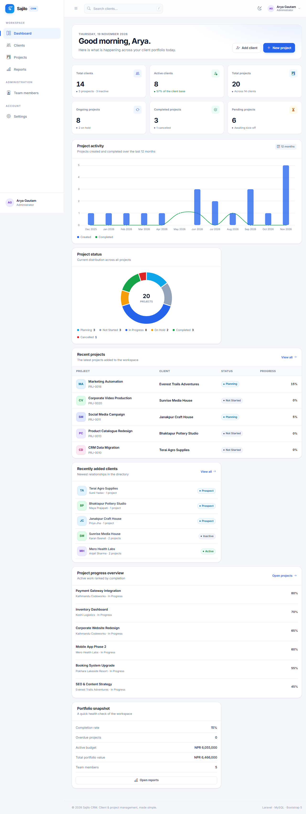

# Sajilo CRM

A complete client and project management web application built for the Sajilo Studio industrial training project It pairs a Laravel 12 REST API with a server-rendered, responsive Bootstrap 5 interface and a MariaDB/MySQL database.

The application is intentionally framework-first: Blade, vanilla JavaScript, Bootstrap 5, Bootstrap Icons and Chart.js. There is no React, Vue, Alpine or CDN dependency, so it runs fully offline after `composer install`.



---

## 1. Feature summary

| Area | What is included |
| --- | --- |
| Authentication | Session login for the web UI, Sanctum Bearer tokens for the API, login throttling, "remember me", last sign-in tracking, sign-out |
| Roles | Admin and Staff roles enforced by middleware and Laravel policies; navigation and row actions adapt to the signed-in user |
| Dashboard | Live KPI cards, client/project status charts, monthly delivery chart, recent projects, recent clients, project progress overview |
| Clients | Create, read, update, delete, logo upload, detail modal with linked projects, backend search, status filter, sorting, pagination, CSV export |
| Projects | Create, read, update, delete, client assignment, team assignment, priority, budget, progress, due dates, overdue detection, tabbed detail page (Overview / Client / Details), CSV export |
| Reports | Portfolio KPIs, delivery activity chart, status and priority breakdowns, team workload, top clients, budget by status, recent completions |
| Settings | Profile update, password change, light/dark/system appearance preference |
| Team (admin) | Create, edit and remove team members, role management, password resets, self-protection rules |
| API | JSON REST endpoints for every module, Form Request validation, API Resources, consistent response envelopes, role restrictions |
| Errors | Branded 403, 404, 419, 429, 500 and 503 pages; JSON errors for API requests |
| Accessibility | Skip link, semantic landmarks, labelled controls, focus states, reduced-motion support, keyboard-friendly modals |
| Tests | 62 feature and unit tests (374 assertions) covering auth, roles, CRUD, validation, filtering, reports, CSV exports and pages |

---

## 2. Technology stack

- **PHP 8.4** (Laravel 12 requires PHP 8.2+)
- **Laravel 12.73**
- **MariaDB 11.4** (MySQL 8 compatible)
- **Laravel Sanctum** for API tokens
- **Bootstrap 5.3.8**, **Bootstrap Icons 1.13.1**, **Chart.js 4.5.1** served locally
- **Blade + vanilla JavaScript** for the front end
- **PHPUnit 11** with SQLite in-memory database for tests
- **Laravel Pint** for code style

Front-end assets are committed under `public/assets/vendor/`; nothing is fetched from a CDN at runtime.

---

## 3. Demo credentials

All seeded accounts use the password **`Sajilo@2026`**.

| Role | Name | Email | Password |
| --- | --- | --- | --- |
| Administrator | Arya Gautam | `arya@gmail.com` | `Sajilo@2026` |
| Staff | Prakriti Adhikari | `prakriti@sajilocrm.test` | `Sajilo@2026` |
| Staff | Rohan Karki | `rohan@sajilocrm.test` | `Sajilo@2026` |
| Staff | Udesh Shrestha | `udesh@sajilocrm.test` | `Sajilo@2026` |
| Staff | Suraj Thakuri | `suraj@sajilocrm.test` | `Sajilo@2026` |

The seeder creates **14 fictional clients** and **20 fictional projects** across active, prospect and inactive clients, with planning, in-progress, on-hold, completed and cancelled projects.

### Role capabilities

| Capability | Admin | Staff |
| --- | --- | --- |
| View dashboard, clients, projects and reports | Yes | Yes |
| Create and update clients | Yes | Yes |
| Delete clients | Yes | No |
| Create projects | Yes | Yes (automatically assigned to self) |
| Update projects | Any project | Only projects assigned to them |
| Delete projects | Yes | No |
| Manage team members | Yes | No |
| Update own profile and password | Yes | Yes |

---

## 4. Run the application

### 4.1 Standard setup (PHP and MySQL already installed)

```bash
composer install
copy .env.example .env
php artisan key:generate
```

Create the database and application user:

```sql
CREATE DATABASE sajilo_crm CHARACTER SET utf8mb4 COLLATE utf8mb4_unicode_ci;
CREATE USER 'sajilo'@'127.0.0.1' IDENTIFIED BY 'Sajilo@2026';
GRANT ALL PRIVILEGES ON sajilo_crm.* TO 'sajilo'@'127.0.0.1';
FLUSH PRIVILEGES;
```

Set these values in `.env`:

```dotenv
APP_URL=http://127.0.0.1:8000
DB_CONNECTION=mysql
DB_HOST=127.0.0.1
DB_PORT=3306
DB_DATABASE=sajilo_crm
DB_USERNAME=sajilo
DB_PASSWORD=Sajilo@2026
FILESYSTEM_DISK=uploads
```

Then migrate, seed and serve:

```bash
php artisan migrate --seed
php artisan serve --host=127.0.0.1 --port=8000
```

Open <http://127.0.0.1:8000> and sign in with the demo administrator account.

> `php artisan migrate:fresh --seed` resets the database and re-creates the demo data. Use it only when you want a clean demo state.

### 4.2 Portable setup used on this machine

PHP, Composer and MariaDB are installed under `C:\Users\aryag\tools` without administrator privileges.

Start MariaDB (if it is not already running):

```powershell
Start-Process 'C:\Users\aryag\tools\mariadb\bin\mysqld.exe' `
  -ArgumentList '--datadir=C:\Users\aryag\tools\mariadb-data','--port=3306','--bind-address=127.0.0.1','--console' `
  -WindowStyle Hidden `
  -RedirectStandardOutput 'C:\Users\aryag\tools\mariadb.out.log' `
  -RedirectStandardError 'C:\Users\aryag\tools\mariadb.err.log'
```

Start the application:

```powershell
cd C:\Users\aryag\SajiloCRM
& 'C:\Users\aryag\tools\php\php.exe' artisan serve --host=127.0.0.1 --port=8000
```

Useful URLs:

| Page | URL |
| --- | --- |
| Login | <http://127.0.0.1:8000/login> |
| Dashboard | <http://127.0.0.1:8000/> |
| API base | <http://127.0.0.1:8000/api> |

### 4.3 Environment notes

- Application timezone: `Asia/Kathmandu`.
- Currency: `NPR` (configured in `config/crm.php`).
- Client logos are stored in `public/uploads/clients` through the `uploads` disk, so no storage symlink is required on Windows.
- Public uploads are capped at 2 MB; accepted formats are JPG, PNG and WebP.

---

## 5. Project structure

```
app/
  Http/
    Controllers/Api/       REST API controllers
    Controllers/Web/       Page and CSV export controllers
    Controllers/Auth/      Session login controller
    Middleware/            EnsureUserIsAdmin
    Requests/              Form Request validation
    Resources/             API Resources
  Models/                  User, Client, Project
  Policies/                ClientPolicy, ProjectPolicy
  Queries/                 ClientQuery, ProjectQuery (search, filter, sort)
  Support/                 ApiResponse, Csv helpers
config/crm.php             Status, priority, colour and upload settings
database/
  factories/               User, Client, Project factories
  migrations/              Schema
  seeders/                 Demo data
public/assets/
  css/app.css              Design system
  js/                      Page controllers and shared runtime
  vendor/                  Bootstrap, Icons, Chart.js, Inter font
resources/views/           Blade pages, components, layouts, error pages
routes/web.php             Web pages, exports, auth
routes/api.php             REST API
tests/Feature/             API, page and export coverage
tests/Unit/                Model helper and CSV coverage
docs/                      API reference, Postman collection, screenshots
```

---

## 6. REST API

Every response is JSON. Successful responses use:

```json
{
  "success": true,
  "message": "Optional message",
  "data": {}
}
```

Paginated responses add `data`, `links` and `meta`. Validation failures return HTTP 422 with `message` and `errors`. Authentication failures return 401, policy failures 403, missing records 404 and conflicts 409.

### Authentication

PowerShell:

```powershell
$body = @{ email = 'admin@sajilocrm.test'; password = 'Sajilo@2026' } | ConvertTo-Json
$login = Invoke-RestMethod -Method Post `
  -Uri 'http://127.0.0.1:8000/api/auth/login' `
  -ContentType 'application/json' -Body $body

$token = $login.data.token
$headers = @{ Authorization = "Bearer $token"; Accept = 'application/json' }

Invoke-RestMethod -Uri 'http://127.0.0.1:8000/api/clients?per_page=5' -Headers $headers
```

cURL (macOS/Linux or Windows `curl.exe`):

```bash
curl -X POST http://127.0.0.1:8000/api/auth/login \
  -H "Accept: application/json" \
  -H "Content-Type: application/json" \
  -d '{"email":"admin@sajilocrm.test","password":"Sajilo@2026"}'

curl http://127.0.0.1:8000/api/clients \
  -H "Accept: application/json" \
  -H "Authorization: Bearer YOUR_TOKEN"
```

### Endpoints

| Method | Endpoint | Access | Purpose |
| --- | --- | --- | --- |
| POST | `/api/auth/login` | Public | Return a Sanctum Bearer token |
| GET | `/api/auth/user` | Authenticated | Current user |
| POST | `/api/auth/logout` | Authenticated | Revoke the current token |
| GET | `/api/dashboard/statistics` | Authenticated | Dashboard cards and recent activity |
| GET | `/api/dashboard/charts` | Authenticated | Chart series |
| GET | `/api/reports/summary` | Authenticated | Aggregated report data |
| GET | `/api/clients` | Authenticated | Paginated client list |
| POST | `/api/clients` | Authenticated | Create client |
| GET | `/api/clients/{id}` | Authenticated | Client detail with projects |
| PUT/PATCH | `/api/clients/{id}` | Authenticated | Update client |
| DELETE | `/api/clients/{id}` | Admin | Delete client (409 if projects exist) |
| GET | `/api/projects` | Authenticated | Paginated project list |
| POST | `/api/projects` | Authenticated | Create project |
| GET | `/api/projects/{id}` | Authenticated | Project detail |
| PUT/PATCH | `/api/projects/{id}` | Admin or assignee | Update project |
| DELETE | `/api/projects/{id}` | Admin | Delete project |
| GET | `/api/users` | Admin | Paginated team list |
| POST | `/api/users` | Admin | Create team member |
| PUT/PATCH | `/api/users/{id}` | Admin | Update team member |
| DELETE | `/api/users/{id}` | Admin | Remove team member |
| PUT | `/api/settings/profile` | Authenticated | Update own profile |
| PUT | `/api/settings/password` | Authenticated | Change password and revoke other tokens |

### Query parameters

Clients: `q`, `status`, `sort`, `direction`, `per_page`, `page`.

Projects: `q`, `status`, `priority`, `client_id`, `assigned_to`, `overdue=1`, `sort`, `direction`, `per_page`, `page`.

Team: `q`, `role`, `sort`, `direction`, `per_page`, `page`.

Full request and response examples are in [`docs/API.md`](docs/API.md). A ready-to-import Postman collection is at [`docs/Sajilo-CRM.postman_collection.json`](docs/Sajilo-CRM.postman_collection.json).

### CSV exports

The web UI downloads filtered CSV files from:

- `GET /clients/export?q=&status=`
- `GET /projects/export?q=&status=&priority=&client_id=&assigned_to=&overdue=`

Both exports are session-authenticated, UTF-8 with a BOM for Excel, and protect against spreadsheet formula injection by prefixing risky values with an apostrophe.

---

## 7. Testing

The test suite uses an in-memory SQLite database configured in `phpunit.xml`, so it does not touch the demo MySQL data.

```bash
php artisan test
```

Current result:

```
Tests:    62 passed (374 assertions)
Duration: ~2.0s
```

Coverage highlights:

- Session login, logout, guest redirects, API token login and revocation
- Client CRUD, validation, logo upload, staff delete restriction, delete conflict
- Project CRUD, staff auto-assignment, assigned-only updates, completion timestamps, overdue filtering
- Dashboard and report aggregation against a known fixture
- Admin team management, self-protection, password hashing and project unassignment
- Profile/password settings and token revocation
- CSV content, filtering and formula-injection escaping
- Blade page smoke tests and branded 403/404 pages
- Unit tests for initials, project codes, overdue logic, labels and CSV safety

Run the style check with:

```bash
vendor/bin/pint --test
```

---

## 8. Screenshots

Screenshots are stored in `docs/screenshots/`:

| Screen | File |
| --- | --- |
| Login | `01-login.png` |
| Dashboard | `02-dashboard.png` |
| Clients | `03-clients.png` |
| Client detail modal | `04-client-detail.png` |
| Projects | `05-projects.png` |
| Project detail | `06-project-detail.png` |
| Reports | `07-reports.png` |
| Settings | `08-settings.png` |
| Team members | `09-team-members.png` |
| Dark mode | `10-dark-mode.png` |

---

## 9. Design and implementation notes

- **No hard-coded dashboard values.** Every card, chart and report figure is computed from the database through the API.
- **Server-side list management.** Search, filtering, sorting and pagination happen in `ClientQuery` and `ProjectQuery`; the browser only stores UI state in the URL.
- **Consistent API contract.** `ApiResponse` centralises success, error and pagination envelopes.
- **Role security in depth.** Admin routes are protected by the `admin` middleware; object-level rules live in policies and Form Requests.
- **Transactions.** Create/update/delete operations that touch records and files are wrapped in `DB::transaction`.
- **Safe uploads.** Logos are validated as images, stored on a dedicated disk and removed when replaced or deleted.
- **Progressive enhancement.** Pages render useful server-side HTML even before JavaScript loads; API-driven tables then hydrate from the database.
- **Accessibility.** Charts include text alternatives, tables use labels and `aria-live` regions announce asynchronous results, and `prefers-reduced-motion` disables KPI count-up animation.

---

## 10. Known constraints

- This is a training/demo application. It seeds fictional data and is not hardened for public internet exposure.
- SQLite is used only for automated tests; the demo uses MariaDB.
- Email verification and password reset emails are not part of Chapter 4 scope. Passwords can be changed from Settings and reset by an administrator from the Team page.
- Client logos are served directly from `public/uploads`; in a large deployment this would move to object storage.

---

## 11. Credits

Built by **Arya Gautam** for the Sajilo Studio industrial training report, 2026.

Laravel, Bootstrap, Bootstrap Icons, Chart.js and Inter are used under their respective open-source licences.
